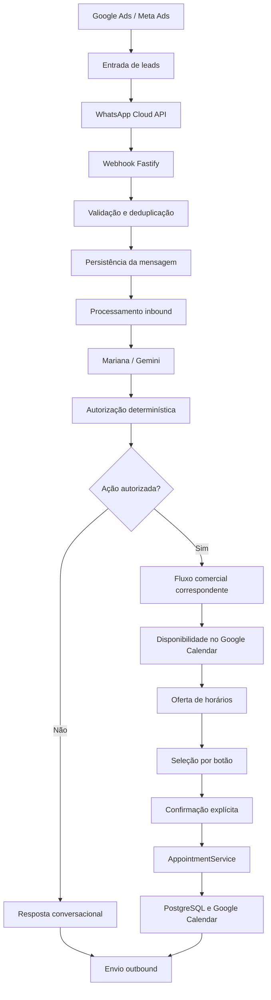

# 🧠 Mariana

<p align="left">
  
  
  
  
  
</p>

<p align="left">
  
  
  
</p>

**Mariana** é um agente de atendimento comercial desenvolvido em TypeScript para automatizar a comunicação com leads pelo WhatsApp, conduzir a qualificação comercial com apoio de inteligência artificial e facilitar o agendamento de conversas com consultores.

O sistema integra WhatsApp Cloud API, Google Gemini, PostgreSQL e Google Calendar. Sua arquitetura separa a geração de respostas por IA das regras determinísticas responsáveis por autorizar ações comerciais, validar horários e controlar o estado dos agendamentos.

<p align="left">
  <a href="https://github.com/DaviC18/Mariana">Repositório</a> ·
  <a href="https://github.com/DaviC18/Mariana/tree/develop">Branch develop</a> ·
  <a href="https://www.linkedin.com/in/david-curty-84b2a0285/">LinkedIn</a>
</p>

> **Estado do projeto:** 14 de outubro de 2026  
> **Branch de referência:** `develop`  
> **Foco atual:** confiabilidade do processamento inbound/outbound, autorização de ações comerciais e validação integrada do agendamento.

---

## Sumário

- [Visão geral](#visão-geral)
- [Funcionalidades](#funcionalidades)
- [Arquitetura](#arquitetura)
- [Fluxo de atendimento](#fluxo-de-atendimento)
- [Autorização comercial](#autorização-comercial)
- [Processamento de mensagens](#processamento-de-mensagens)
- [Fluxo de agendamento](#fluxo-de-agendamento)
- [Persistência e idempotência](#persistência-e-idempotência)
- [Tecnologias](#tecnologias)
- [Estrutura do projeto](#estrutura-do-projeto)
- [Instalação e configuração](#instalação-e-configuração)
- [Scripts disponíveis](#scripts-disponíveis)
- [Banco de dados e migrations](#banco-de-dados-e-migrations)
- [Segurança e confiabilidade](#segurança-e-confiabilidade)
- [Testes e validação](#testes-e-validação)
- [Estado atual e limitações](#estado-atual-e-limitações)
- [Roadmap](#roadmap)
- [Licença](#licença)

---

## Visão geral

A Mariana foi projetada para reduzir o trabalho manual no primeiro atendimento comercial. O agente recebe mensagens, utiliza o contexto da conversa para responder ao cliente, coleta informações relevantes e pode encaminhar o lead para um consultor quando as regras comerciais forem atendidas.

O sistema também possui integrações para ingestão de leads provenientes de campanhas de Google Ads e Meta Ads.

### Fluxo de alto nível



A arquitetura segue um princípio central:

> **A IA conduz a conversa; o backend determinístico controla as ações comerciais e o estado do agendamento.**

Uma resposta gerada pelo modelo não deve, por si só, autorizar uma operação de negócio que dependa de qualificação, intenção explícita ou validações de estado.

## Funcionalidades

### Atendimento e mensageria

- Recebimento de eventos pela WhatsApp Cloud API.
- Validação da assinatura do webhook.
- Identificação de leads pelo telefone.
- Criação e reutilização de conversas.
- Persistência de mensagens de usuário e assistente.
- Recebimento de mensagens de texto e respostas interativas `button_reply`.
- Envio de mensagens de texto e botões interativos.
- Registro de eventos inbound e identificadores externos.
- Deduplicação por identificador externo, incluindo WAMIDs quando disponíveis.
- Processamento de mensagens pendentes por tarefas autônomas.
- Mecanismos de idempotência, tentativas e recuperação de tarefas no backend.

A presença desses mecanismos não significa que todas as condições de recuperação, concorrência e entrega foram validadas em um ambiente integrado. Esses cenários permanecem parte da validação de confiabilidade.

### Qualificação comercial

O fluxo de qualificação utiliza os estados comerciais existentes no projeto, incluindo:

```text
new → qualifying → qualified → scheduled
```

Os dados considerados pelo fluxo podem incluir:

- Data de nascimento e maioridade.
- Objetivo do cliente.
- Tipo de consórcio.
- Situação atual.
- Dor ou motivação.
- Interesse em conversar com um consultor.

A promoção do lead e a execução das ações comerciais devem respeitar os requisitos definidos no backend. A IA pode sugerir atualizações de qualificação, mas não substitui as validações determinísticas.

### Inteligência artificial

O Google Gemini é utilizado para:

- Compreensão de mensagens em linguagem natural.
- Geração de respostas contextuais.
- Condução do diálogo.
- Apoio à qualificação do lead.
- Proposição de próximas ações conversacionais.

O modelo não deve ser a autoridade final para:

- Autorizar um agendamento apenas porque o lead está qualificado.
- Inventar disponibilidade ou horários.
- Selecionar arbitrariamente um consultor.
- Validar IDs de slots ou botões sem consultar o estado persistido.
- Confirmar um agendamento sem a confirmação explícita do cliente.

### Agendamento

O sistema possui serviços separados para:

- Consulta de disponibilidade.
- Oferta de horários.
- Persistência de sessões e slots.
- Seleção de horário.
- Confirmação e cancelamento.
- Expiração de sessões.
- Criação de appointments.
- Integração com Google Calendar.

As validações do backend continuam obrigatórias mesmo quando a IA identifica corretamente a intenção do cliente.

---

## Arquitetura

A aplicação utiliza Node.js, TypeScript e Fastify, com separação entre rotas HTTP, integrações externas, serviços de domínio, processamento assíncrono e persistência.

### Responsabilidades das principais camadas

| Camada | Responsabilidade |
|---|---|
| Webhook WhatsApp | Receber, validar e encaminhar eventos |
| Integração WhatsApp | Enviar mensagens e botões pela Cloud API |
| Leads | Persistir e atualizar informações comerciais |
| Conversas | Coordenar histórico, contexto e respostas |
| Gemini | Gerar respostas e apoiar a qualificação |
| Autorização comercial | Validar se uma ação está autorizada |
| Tarefas autônomas | Processar mensagens e operações assíncronas |
| Outbound | Coordenar o envio e a recuperação de mensagens |
| Disponibilidade | Consultar horários e conflitos |
| Scheduling | Controlar ofertas, sessões, seleção e confirmação |
| AppointmentService | Validar e executar o agendamento |
| PostgreSQL / Drizzle | Persistência, constraints e migrations |
| Google Calendar | Consultar disponibilidade e criar eventos |

### Separação entre IA e regras de negócio

A arquitetura procura manter três responsabilidades distintas:

1. **Interpretação:** compreender o que o cliente escreveu.
2. **Autorização:** verificar deterministicamente se a ação proposta é permitida no contexto atual.
3. **Execução:** realizar a operação por meio dos serviços de domínio, respeitando as validações persistidas.

Essa separação reduz o risco de uma resposta contextual ou de uma mensagem antiga provocar efeitos comerciais não solicitados.

---

## Fluxo de atendimento

### Mensagens de texto

O fluxo de alto nível é:

```text
WhatsApp Cloud API
        │
        ▼
webhook-whatsapp
        │
        ├── validação da assinatura
        ├── identificação do evento
        ├── deduplicação
        └── identificação do lead/conversa
                    │
                    ▼
         receiveCustomerMessage
                    │
                    ▼
         Persistência inbound
                    │
                    ▼
        Tarefa de processamento
                    │
                    ▼
       autonomous-task-executor
                    │
                    ▼
       generateMarianaResponse
                    │
                    ▼
             Gemini / IA
                    │
                    ▼
      Autorização da próxima ação
                    │
                    ▼
         Persistência da resposta
                    │
                    ▼
          Outbound / WhatsApp
```

O processamento inbound considera mensagens pendentes de uma conversa e utiliza tarefas para coordenar sua execução. O agrupamento de mensagens deve preservar a ordem, permitir recuperação após falhas e evitar que mensagens antigas e sem relação com a interação atual contaminem uma nova resposta.

A confiabilidade desse fluxo depende não apenas da deduplicação de webhooks, mas também da coordenação entre persistência, tarefas, resposta gerada e envio outbound.

### Respostas interativas

Respostas `interactive.button_reply` seguem um caminho determinístico, distinto do processamento conversacional de texto.

Identificadores técnicos utilizados pelo fluxo incluem:

```text
<slotId>
confirm:<slotId>
cancel:<slotId>
```

- O ID do slot identifica o horário persistido.
- `confirm:<slotId>` solicita a confirmação do horário selecionado.
- `cancel:<slotId>` representa a rejeição da confirmação.

A identidade do horário é resolvida no backend. A posição visual do botão não deve ser considerada suficiente para identificar um slot.

As operações precisam respeitar a propriedade da sessão, o vínculo com lead e conversa, a validade temporal e a seleção persistida.

---

## Autorização comercial

A autorização de ações comerciais é uma proteção determinística do backend.

### Agendamento não é consequência automática da qualificação

Um lead no estado `qualified` não deve receber automaticamente uma oferta de horários. A ação de agendamento também precisa ser autorizada pela intenção expressa nas mensagens atuais.

Por exemplo:

| Mensagem atual | Comportamento esperado |
|---|---|
| “Olá, Mariana” | Responder à saudação sem iniciar automaticamente um agendamento |
| “Boa tarde” | Responder naturalmente, sem presumir interesse em horários |
| “Quero agendar uma conversa” | Considerar o fluxo de agendamento, se os requisitos comerciais forem atendidos |
| “Quais horários estão disponíveis?” | Considerar a consulta de disponibilidade, respeitando a qualificação |
| “Quero falar com um consultor” | Tratar como encaminhamento comercial; não presumir automaticamente que o cliente pediu um horário |

O sistema normaliza a mensagem para reconhecer expressões de intenção em português, incluindo variações de acentuação e capitalização.

A identificação de uma expressão compatível não elimina os demais requisitos. A qualificação do lead e as regras de negócio continuam sendo verificadas.

### Encaminhamento e agendamento são ações diferentes

A ação `request_consultant` não deve ser convertida indiscriminadamente em `offer_meeting`.

O encaminhamento comercial pode ser legítimo mesmo quando o cliente ainda não solicitou um horário. A autorização do agendamento precisa seguir suas próprias regras.

### Histórico versus intenção atual

O histórico fornece contexto para a conversa, mas um pedido antigo de agendamento não deve autorizar automaticamente uma nova oferta depois que o cliente envia uma mensagem atual sem relação com esse pedido.

Essa distinção é importante para evitar que saudações ou outras mensagens simples provoquem respostas comerciais inesperadas.

### Testes de regressão

A cobertura direcionada inclui cenários como:

- Saudação enviada por lead qualificado.
- Saudação enviada por lead em qualificação.
- Pedido explícito de agendamento.
- Pedido de disponibilidade.
- Intenção histórica seguida de saudação atual.
- Encaminhamento para consultor.
- Respeito aos requisitos de qualificação.

Os testes direcionados aprovados não substituem a validação integrada do fluxo completo.

---

## Processamento de mensagens

### Processamento inbound e tarefas

A aplicação utiliza a infraestrutura de tarefas autônomas para coordenar operações assíncronas.

Os componentes relacionados incluem:

- `autonomous-task-executor.ts`
- `autonomous-task-handlers.ts`
- `generateMarianaResponse.ts`
- `receive-customer-message.ts`

O processamento deve preservar:

- Ordem de execução por conversa.
- Recuperação de mensagens pendentes.
- Idempotência durante tentativas repetidas.
- Tratamento de falhas e tentativas.
- Consistência entre a mensagem recebida e a resposta gerada.

A seleção do lote de mensagens precisa ser compatível com o ciclo de vida da tarefa. Filtrar exclusivamente pela mensagem que disparou o webhook pode deixar mensagens pendentes sem processamento; agrupar indiscriminadamente mensagens antigas também pode produzir respostas inadequadas.

### Processamento outbound

O envio de respostas pelo WhatsApp depende da conectividade com a Meta e do estado persistido da operação.

Um timeout de rede não comprova que a Meta deixou de receber uma requisição. Por isso, a recuperação de mensagens outbound deve considerar a possibilidade de resultado desconhecido e evitar repetições indevidas.

Em 14 de outubro de 2026, foi observado um erro `ETIMEDOUT` durante uma tentativa de envio. Testes posteriores ao domínio `graph.facebook.com` responderam rapidamente, mas esses testes não comprovaram a entrega de mensagens pelo endpoint de envio do WhatsApp.

O tratamento específico desse incidente, incluindo a política de retry e o risco de duplicação, permanece sujeito a auditoria.

---

## Fluxo de agendamento

### 1. Oferta de horários

O serviço de disponibilidade consulta os calendários dos consultores e identifica os horários elegíveis.

O `SchedulingOfferService` persiste a sessão e os slots antes de apresentá-los ao usuário. O fluxo prevê até três opções por oferta, respeitando a disponibilidade real.

A disponibilidade não deve ser inventada pelo modelo.

### 2. Seleção

O `SchedulingChoiceService` valida a seleção recebida.

Entre as condições relevantes estão:

- Existência do slot.
- Vínculo do slot com a sessão correta.
- Correspondência entre lead e conversa.
- Sessão ativa e não expirada.
- Compatibilidade com a seleção já persistida.

A seleção é armazenada em `scheduling_sessions.selectedSlotId`.

Em ofertas com dois ou três horários, o sistema pode solicitar a confirmação do horário escolhido. Em uma oferta com um único horário, pode solicitar diretamente a confirmação desse slot.

### 3. Confirmação

O `SchedulingConfirmationService` valida a confirmação e o slot selecionado. O `SchedulingConfirmationOrchestrator` coordena a operação e encaminha o processo ao `AppointmentService`.

O fluxo de confirmação utiliza as validações do domínio antes de criar o agendamento.

### 4. Criação do appointment

O `AppointmentService` é responsável pelas validações finais e pela criação do compromisso.

O fluxo documentado inclui verificações de:

- Intervalo de tempo.
- Consultor e estado correspondente.
- Qualificação do lead.
- Estado e expiração da sessão, quando aplicáveis.
- Conflitos no PostgreSQL.
- Disponibilidade no Google Calendar.

Após as verificações, o sistema cria o evento externo e persiste o appointment de acordo com as regras do serviço.

**Limitação:** PostgreSQL e Google Calendar não participam de uma única transação distribuída. Uma falha entre a criação do evento externo e a persistência final pode exigir compensação e recuperação. Os cenários de falha e concorrência precisam ser validados em ambiente de integração.

### 5. Cancelamento ou rejeição

O cancelamento ou a rejeição da confirmação deve respeitar o estado persistido da sessão.

O comportamento depende do fluxo de oferta: uma seleção rejeitada pode permitir uma nova escolha entre horários já apresentados, enquanto uma sessão com um único horário pode ser encerrada segundo as regras do serviço.

O sistema não deve interpretar uma rejeição como autorização para criar um agendamento.

### 6. Expiração

As sessões possuem estado e prazo de validade. Uma sessão expirada não deve permitir seleção ou confirmação.

O backend deve validar novamente a validade no momento da operação, mesmo que o botão tenha sido apresentado quando a sessão ainda estava ativa.

---

## Persistência e idempotência

### Entidades principais

| Tabela | Responsabilidade |
|---|---|
| `leads` | Identidade e estado comercial |
| `conversations` | Contexto de atendimento |
| `messages` | Histórico de mensagens |
| `consultants` | Cadastro dos consultores |
| `appointments` | Agendamentos |
| `scheduling_sessions` | Estado e validade das ofertas |
| `scheduling_slots` | Horários apresentados |
| `whatsapp_webhook_events` | Registro e idempotência de eventos inbound |
| `autonomous_tasks` | Execução assíncrona de tarefas |

### Identificadores externos

A tabela `messages` possui o campo `externalId` para mapear identificadores externos, incluindo WAMIDs do WhatsApp.

Um índice único parcial impede a duplicação do identificador externo quando ele não é nulo.

### Eventos do webhook

A tabela `whatsapp_webhook_events` mantém informações de eventos recebidos, incluindo identificador externo, tipo, origem, payload persistido, estado e datas de processamento.

Os estados documentados incluem:

```text
processing
processed
failed
```

A unicidade do identificador externo é parte da proteção contra processamento duplicado.

Entretanto, deduplicação e recuperação são responsabilidades diferentes: o sistema precisa reconhecer um evento repetido sem descartar uma operação legítima que ainda não tenha sido concluída.

### Tarefas autônomas

A tabela `autonomous_tasks` suporta o processamento de tarefas, com estados, tentativas e mecanismos de idempotência.

O executor coordena a execução e a recuperação conforme as regras implementadas no projeto.

A validação integrada ainda precisa demonstrar que falhas, concorrência e reinicializações não causam perda de mensagens, respostas duplicadas ou repetição de efeitos comerciais.

### Migrations relevantes

A branch `develop` contém migrations recentes relacionadas a:

- Persistência da seleção do slot em `scheduling_sessions.selectedSlotId`.
- Registro e idempotência de eventos do webhook do WhatsApp.

Antes de implantar o projeto em outro ambiente, confirme que todas as migrations necessárias foram aplicadas ao banco correspondente.

---

## Tecnologias

| Tecnologia | Finalidade |
|---|---|
| Node.js 24 | Runtime |
| TypeScript | Linguagem principal |
| Fastify 5 | Servidor HTTP |
| Zod | Validação de dados e contratos |
| PostgreSQL | Persistência |
| Drizzle ORM | Schema, queries e migrations |
| Google GenAI SDK | Integração com Gemini |
| WhatsApp Cloud API | Mensageria |
| Google Calendar API | Disponibilidade e eventos |
| `tsx` | Execução TypeScript e testes |
| `tsup` | Build |
| Ultracite / Biome | Verificação e padronização |
| Docker | Suporte ao ambiente de desenvolvimento |
| ngrok | Exposição local do webhook durante testes |

---

## Estrutura do projeto

A estrutura abaixo destaca os principais componentes do backend:

```text
src/
├── db/
│   └── schema/
│       ├── appointments.ts
│       ├── autonomous-tasks.ts
│       ├── consultants.ts
│       ├── conversations.ts
│       ├── leads.ts
│       ├── messages.ts
│       ├── relations.ts
│       ├── scheduling-sessions.ts
│       ├── scheduling-slots.ts
│       └── whatsapp-webhook-events.ts
├── integrations/
│   └── whatsapp/
│       ├── whatsapp-client.ts
│       ├── whatsapp-service.ts
│       └── whatsapp-types.ts
├── routes/
│   ├── appointments/
│   ├── conversations/
│   ├── google-calendar/
│   ├── google-ads/
│   ├── leads/
│   ├── messages/
│   ├── meta-ads/
│   └── whatsapp/
│       └── webhook-whatsapp.ts
├── services/
│   ├── calendar/
│   │   ├── appointment-service.ts
│   │   ├── availability.ts
│   │   ├── scheduling-availability.ts
│   │   ├── scheduling-cancellation-service.ts
│   │   ├── scheduling-choice-service.ts
│   │   ├── scheduling-confirmation-orchestrator.ts
│   │   ├── scheduling-confirmation-service.ts
│   │   ├── scheduling-offer-service.ts
│   │   └── scheduling-session-expiration.ts
│   ├── conversations/
│   │   ├── autonomous-task-executor.ts
│   │   ├── autonomous-task-handlers.ts
│   │   ├── generateMarianaResponse.ts
│   │   ├── receive-customer-message.ts
│   │   └── whatsapp-compliance.ts
│   ├── agent/
│   └── leads/
├── tests/
│   ├── integrations/
│   ├── reliability/
│   ├── routes/
│   └── services/
├── utils/
└── server.ts

drizzle/
└── ... migrations ...
```

A estrutura é ilustrativa e não representa todos os arquivos existentes no repositório.

---

## Instalação e configuração

### Pré-requisitos

- Node.js 24.
- npm.
- PostgreSQL.
- Credenciais do Google Gemini.
- Configuração de acesso ao Google Calendar.
- Aplicativo e número configurados na WhatsApp Cloud API.
- URL pública para receber webhooks durante testes locais, quando necessária.

### 1. Clonar o repositório

```bash
git clone https://github.com/DaviC18/Mariana.git
cd Mariana
```

Para trabalhar na branch de desenvolvimento:

```bash
git switch develop
git pull origin develop
```

Se já houver alterações locais, verifique o estado do Git antes de atualizar ou trocar de branch.

### 2. Instalar dependências

```bash
npm install
```

### 3. Configurar as variáveis de ambiente

Crie o arquivo `.env` seguindo os nomes e formatos exigidos por `src/env.ts`.

Não compartilhe tokens, API keys, refresh tokens, segredos de webhook ou strings de conexão reais.

### 4. Aplicar migrations

Somente depois de confirmar que `DATABASE_URL` aponta para o banco correto:

```bash
npm run db:migrate
```

**Atenção:** esse comando altera o banco configurado. Não o execute contra produção ou contra um banco compartilhado sem confirmar o destino e o procedimento de implantação.

### 5. Executar em desenvolvimento

```bash
npm run dev
```

### 6. Executar os testes

Para executar a suíte configurada:

```bash
npm run test
```

O script utiliza `tsx --test`. Os testes devem ser selecionados e executados conforme suas dependências e efeitos colaterais.

**Importante:** nem todos os testes são isolados. Alguns criam e removem registros no banco definido por `DATABASE_URL`. Não execute esses testes contra um banco real ou compartilhado sem configurar um banco de testes descartável.

### 7. Verificar código e build

```bash
npm run check
npm run build
```

---

## Scripts disponíveis

| Script | Finalidade |
|---|---|
| `npm run dev` | Executa o servidor em modo de desenvolvimento |
| `npm run build` | Gera a build usando `tsup` |
| `npm run start` | Executa a aplicação compilada |
| `npm run test` | Executa os testes usando `tsx --test` |
| `npm run check` | Executa `ultracite check` |
| `npm run fix` | Executa `ultracite fix` |
| `npm run db:generate` | Gera migrations com Drizzle Kit |
| `npm run db:migrate` | Aplica migrations |
| `npm run db:seed` | Executa o seed do banco |

Para executar um teste específico, utilize a sintaxe de seleção de arquivos suportada pelo runner e pelo script do projeto. Antes de executar um arquivo, confirme se ele acessa o banco ou serviços externos.

---

## Variáveis de ambiente

A configuração é centralizada em `src/env.ts`.

Os nomes exatos e a obrigatoriedade das variáveis devem ser conferidos nesse arquivo e nos módulos de integração.

As configurações abrangem categorias como:

- Conexão PostgreSQL.
- Chave do Google Gemini.
- Credenciais e configuração do Google Calendar.
- Token de acesso da WhatsApp Cloud API.
- Identificadores do número e da conta do WhatsApp.
- Segredo e token de verificação do webhook.
- Credenciais e identificadores de integrações com Meta Ads.
- Porta e configurações do servidor.

Não registre valores reais dessas variáveis em documentação, logs ou commits.

### Ambiente de testes

Os testes que realizam escrita no banco precisam utilizar um `DATABASE_URL` isolado.

A configuração recomendada para testes de integração é:

1. Criar um banco PostgreSQL descartável.
2. Configurar as variáveis exigidas pelo carregamento do ambiente.
3. Aplicar as migrations nesse banco.
4. Preparar os fixtures necessários, incluindo consultores quando exigidos pelos testes.
5. Manter as integrações externas simuladas, salvo quando um teste externo for explicitamente planejado.
6. Descartar o banco de teste conforme o procedimento definido para o ambiente.

Não utilize o banco de produção como banco de testes.

---

## Banco de dados e migrations

O PostgreSQL é a persistência principal do sistema.

### Sessões de agendamento

A tabela `scheduling_sessions` registra informações como:

- `leadId`.
- `conversationId`.
- `selectedSlotId`.
- `status`.
- `createdAt`.
- `expiresAt`.
- `updatedAt`.

A seleção do horário é persistida para que uma confirmação não possa substituir arbitrariamente o slot originalmente selecionado.

As constraints e os serviços de domínio devem garantir a integridade das sessões e de seus slots relacionados.

### Mensagens e tarefas

As tabelas `messages`, `whatsapp_webhook_events` e `autonomous_tasks` sustentam partes distintas do processamento:

- Histórico de mensagens e IDs externos.
- Registro e deduplicação de eventos inbound.
- Execução assíncrona, tentativas e recuperação de tarefas.

A consistência entre essas estruturas precisa ser validada durante os testes de falha e recuperação.

### Migrations

Antes de executar migrations:

- Confira a branch e o estado do repositório.
- Confirme o banco de destino.
- Verifique as migrations pendentes.
- Utilize um ambiente isolado durante testes.
- Não altere manualmente o journal de migrations sem compreender o histórico e a ordem de aplicação.

---

## Segurança e confiabilidade

### Regras comerciais

Mariana pode explicar conceitos gerais de consórcio, qualificar leads e conduzir encaminhamentos comerciais de acordo com as regras do sistema.

O agente não deve:

- Garantir contemplação ou prazo.
- Inventar disponibilidade ou consultores.
- Tratar uma saudação como pedido de agendamento.
- Autorizar um agendamento apenas pelo status do lead.
- Confundir encaminhamento para consultor com oferta de horários.
- Confirmar um agendamento sem a confirmação explícita do cliente.

### Proteções do backend

A arquitetura inclui mecanismos como:

- Validação da assinatura do webhook.
- Validação de dados e contratos.
- Deduplicação por identificadores externos.
- Persistência de mensagens e tarefas.
- Validação de propriedade e expiração de sessões.
- Seleção persistida de slots.
- Verificação de conflitos antes da criação de appointments.
- Revalidação da disponibilidade no fluxo de confirmação.

### Confiabilidade de envio

Uma falha de rede durante o envio de uma mensagem pode deixar o resultado desconhecido: a requisição pode ter sido aceita remotamente mesmo que o cliente não tenha recebido a resposta HTTP.

O sistema precisa tratar esse cenário com cuidado, evitando considerar uma mensagem entregue sem confirmação e evitando repetições indevidas.

A política efetiva de timeout, retry, backoff e recuperação deve ser validada a partir do código do cliente WhatsApp e do worker outbound.

### Limitações de consistência

PostgreSQL e Google Calendar não participam de uma única transação distribuída. O fluxo pode utilizar compensação quando uma etapa falha, mas a consistência entre os sistemas externos e o banco precisa ser verificada em testes de integração.

A deduplicação de webhooks não garante, isoladamente, entrega de respostas. A recuperação de tarefas, a persistência de estados e a idempotência dos efeitos de negócio precisam funcionar em conjunto.

---

## Testes e validação

O projeto possui testes de integração, rotas, serviços, agendamento e confiabilidade.

### Validação registrada em 14/10/2026

| Verificação | Resultado |
|---|---|
| Testes direcionados de autorização comercial e processamento | 34 testes aprovados |
| Testes de agendamento, compliance e cutoff de mensagens | 9 testes aprovados |
| `npm run check` | Aprovado em 147 arquivos |
| Build com diretório temporário de saída | Aprovado |
| `git diff --check` | Aprovado |
| Suíte completa | Não executada |
| Testes de integração com escrita no banco isolado | Pendentes |

Esses resultados correspondem à validação registrada após as alterações de autorização comercial e processamento em lote. Eles não constituem uma validação completa de todas as integrações externas.

### Arquivos de teste relevantes

```text
src/tests/
├── integrations/
│   └── whatsapp-service.test.ts
├── reliability/
│   ├── autonomous-task-executor.test.ts
│   └── outbound-messages.test.ts
├── routes/
│   └── webhook-whatsapp.test.ts
└── services/
    ├── phase3-scheduling-workflow.test.ts
    ├── scheduling-cancellation-service.test.ts
    ├── scheduling-choice-service.test.ts
    ├── scheduling-confirmation-orchestrator.test.ts
    ├── scheduling-confirmation-service.test.ts
    ├── scheduling-offer-whatsapp.test.ts
    └── scheduling-session.test.ts
```

### Testes de autorização comercial

A cobertura direcionada inclui:

- Bloqueio de ofertas de agendamento a partir de saudações.
- Verificação do estado de qualificação.
- Autorização por intenção explícita atual.
- Separação entre histórico e mensagem atual.
- Distinção entre encaminhamento comercial e agendamento.
- Preservação das regras de qualificação.

### Próxima validação integrada

A validação deve ocorrer em um banco PostgreSQL isolado, com serviços externos simulados quando possível.

Cenários prioritários:

1. Recebimento de mensagens e persistência inbound.
2. Entrega duplicada do mesmo evento.
3. Falha durante o processamento e recuperação posterior.
4. Falha de envio outbound e política de retry.
5. Prevenção de respostas duplicadas.
6. Oferta de um, dois e três horários.
7. Seleção de um slot persistido.
8. Rejeição de confirmação de slot diferente do selecionado.
9. Confirmação e cancelamento.
10. Expiração e propriedade da sessão.
11. Concorrência e recuperação de tarefas.
12. Consistência entre resposta persistida e mensagem enviada.

Os resultados devem ser registrados por comando executado, sem presumir que testes não executados passaram.

---

## Estado atual e limitações

### Implementado na branch `develop`

- Backend em TypeScript e Fastify.
- Integração com WhatsApp Cloud API.
- Integração com Google Gemini.
- Persistência de leads, conversas e mensagens.
- Fluxo de qualificação comercial.
- Autorização determinística de ações comerciais.
- Separação entre encaminhamento para consultor e oferta de agendamento.
- Verificação da intenção de agendamento nas mensagens atuais.
- Processamento de mensagens inbound em lotes.
- Infraestrutura de tarefas autônomas.
- Persistência de sessões e slots de agendamento.
- Seleção persistida do horário.
- Serviços de confirmação e cancelamento.
- Integração com Google Calendar.
- Testes direcionados para autorização comercial e processamento de mensagens.

### Em validação

**1. Recuperação inbound**

É necessário comprovar que mensagens pendentes são recuperadas após falhas e que a delimitação dos lotes não perde mensagens nem mistura interações sem relação.

**2. Envio outbound**

O tratamento de timeouts, o estado persistido da tentativa, os retries e o risco de mensagens duplicadas ainda precisam ser auditados.

**3. Agendamento integrado**

Os testes direcionados passaram, mas os cenários completos de persistência, concorrência, confirmação, cancelamento, expiração e recuperação ainda precisam ser validados em banco isolado.

**4. Integrações externas**

A disponibilidade real do Google Calendar e a entrega de mensagens pelo WhatsApp devem ser testadas em ambiente autorizado. Testes locais de conectividade não comprovam, por si só, a entrega de uma mensagem.

**5. Suíte completa**

A suíte completa não foi executada na validação registrada. O resultado positivo dos testes direcionados não deve ser apresentado como aprovação integral de todos os testes do projeto.

---

## Roadmap

### Etapa atual — Confiabilidade

- Auditar timeout e retry do cliente WhatsApp.
- Validar a recuperação de mensagens inbound.
- Verificar a idempotência das respostas outbound.
- Executar testes de confiabilidade em ambiente isolado.
- Confirmar o comportamento após falhas e reinicializações.

### Etapa seguinte — Validação end-to-end

- Validar o fluxo completo de qualificação.
- Testar ofertas com um, dois e três horários.
- Testar seleção, confirmação, cancelamento e expiração.
- Validar persistência de appointments.
- Validar a integração com Google Calendar.
- Confirmar o envio e o recebimento de mensagens pelo WhatsApp autorizado.
- Executar a suíte completa e registrar os resultados.

### Etapas futuras

- Reagendamento.
- Lembretes de atendimento.
- Melhorias de observabilidade e monitoramento.
- Relatórios operacionais.
- Expansão de recursos conversacionais conforme o escopo do projeto.

---

## Licença

Este README não declara uma licença de distribuição. Consulte os arquivos legais e a configuração do repositório antes de reutilizar ou distribuir o projeto.

---

## Método de desenvolvimento

O desenvolvimento segue um processo incremental:

```text
Análise do código atual
        │
        ▼
Mudança pequena e isolada
        │
        ▼
Teste direcionado
        │
        ▼
Revisão do diff
        │
        ▼
Validação integrada
        │
        ▼
Próxima etapa
```

A branch `develop` é a referência técnica deste documento. Atualize o README quando houver mudanças relevantes na arquitetura, nos fluxos de negócio, nas migrations, nos scripts ou no estado de validação do sistema.
